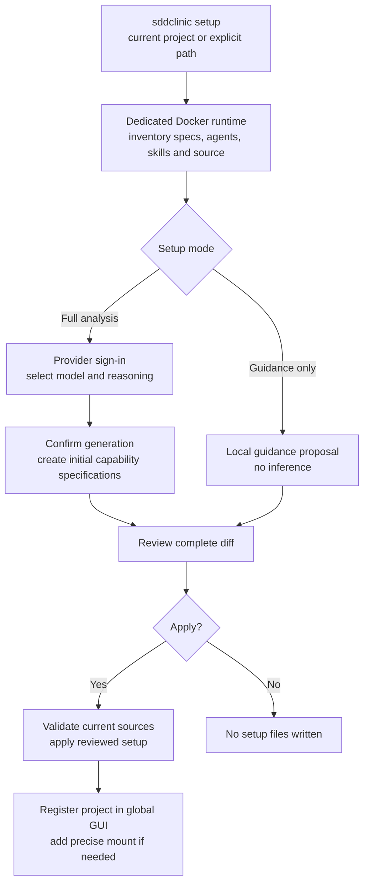
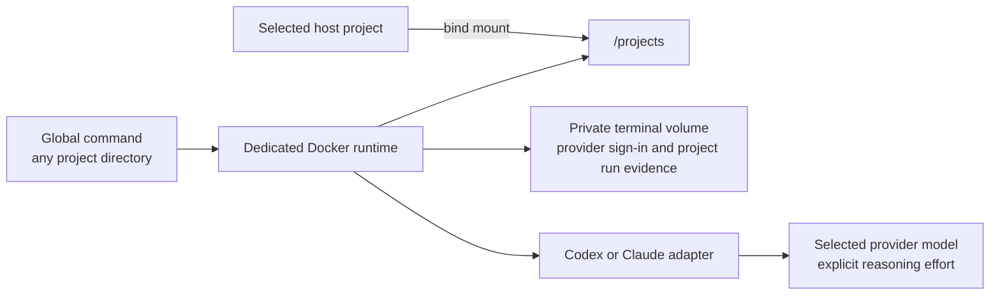
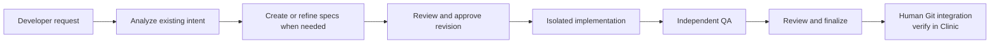
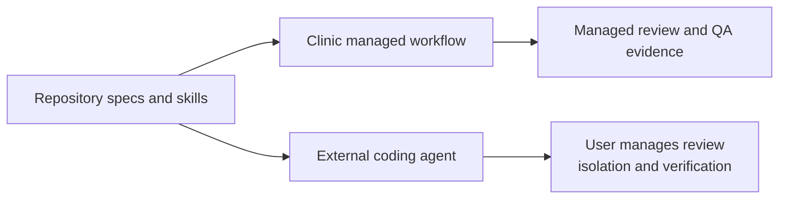

# SDD Clinic installation and CLI guide

Run **`sddclinic setup` inside an existing project** to generate initial capability specifications from bounded project context, review them, and apply SDD setup. Use `--deep` only when you want an exhaustive source audit. The global launcher runs Clinic in Docker; setup does not require the browser. It supports existing repositories across languages and frameworks within the scanner's supported file types and size limits.

## Install the global command

Prerequisites: Node.js 24+, pnpm and Docker with Compose. From a local Clinic source checkout:

```sh
pnpm install --frozen-lockfile
pnpm install:global
```

The installer builds and packs Clinic, installs the package under `~/.local/share/sddclinic/`, and creates `~/.local/bin/sddclinic` and `sdd-clinic`. It adds that directory to your zsh or bash startup file while preserving existing contents. Open a new terminal, or activate the path in your current terminal:

```sh
export PATH="$HOME/.local/bin:$PATH"
sddclinic --help
```

The local installer pins the Node executable used for installation, so it also works when that runtime is not otherwise on your PATH. Reinstall if that Node runtime is removed or relocated. For a custom destination without editing shell startup files:

```sh
pnpm install:global --prefix /absolute/path/to/install --no-path
```

No public npm release is assumed. For package-manager installation on another machine with Node on PATH, build a local archive with `pnpm pack --pack-destination releases`, transfer it, and run `npm install -g /path/to/sdd-clinic-0.1.0.tgz`. The package includes compiled application assets and a dedicated Docker runtime. The first command that needs the runtime builds its image; subsequent calls reuse Docker's build cache. Docker downloads require network access on first build.

## Set up an existing project

```sh
cd /path/to/your-project
sddclinic setup
```

Or specify the project and settings explicitly:

```sh
sddclinic setup /path/to/your-project --engine codex \
  --model gpt-6.1-sol --reasoning medium
```

1. Clinic validates the directory and Docker runtime, then inventories eligible project content. Existing specs, active changes, agent files, skills and exclusions are listed.
2. Select the provider if the project has none. If sign-in is missing, setup automatically opens your system browser for the provider's normal sign-in and waits for completion in this Docker runtime. Host and GUI-runtime sign-in are separate. Codex uses standard browser sign-in rather than device codes, so you do not need to enable device-code access.
3. Select the model and reasoning level. Codex offers its runtime model catalog and recommends `gpt-6.1-sol` when available. Reasoning defaults to `medium`; a previously saved extra-high setting is not silently reused. Explicit supported overrides are allowed.
4. Confirm sending eligible redacted project text to the selected provider. Default setup generates initial specifications directly from selected README/product guidance, manifests, existing specs and representative application files. It makes a generation request followed by a separate quality review, with bounded correction attempts for invalid structured output. Semantic blockers stop setup for refinement rather than asking the reviewer to approve deficient specs. `--deep` instead analyzes all eligible text batches before synthesis.
5. Review the complete diff, including inferred requirements, questions, coverage and the setup model profile. Confirm **Apply these setup changes?** to write the proposal. Declining writes no setup files.
6. After successful application, Clinic registers the project in the global GUI and prints its launch URL. Existing projects are reused. If a mount update would interrupt active work, registration stays pending; finish that work and run `sddclinic start` to retry.
7. Review and commit the files with your normal Git workflow. Setup neither implements product code nor performs Git integration.

Claude uses its own model IDs and effort control. This adapter cannot enumerate account-specific Claude model access, so you enter a supported ID; provider rejection stops analysis without switching model. Unsupported Codex model/effort pairs fail before inference. Every analysis, consolidation and synthesis request uses the selected pair. The reviewed setup profile is saved under `setup` in `.clinic/project.yaml`; unrelated agent model settings are preserved.

To install local guidance without model analysis or sign-in:

```sh
sddclinic setup --guidance-only
```

This installs missing guidance/skills through review and clearly reports that code-derived specifications were not generated. It cannot be combined with `--model` or `--reasoning`.

Setup requires an interactive terminal. Piped input does not bypass review. Ctrl-C cancels pending work. Changed source files or setup targets cause application to be rejected; rerun setup against current content. Repeated setup preserves existing custom instructions and specs. If a process is forcibly killed, a stale setup lock may require removal at the runtime path printed by the diagnostic after checking that no setup is running.



## What setup reads and creates

| Location | Purpose |
| --- | --- |
| `openspec/specs/` | Existing accepted requirements; analysis proposes missing capability specs |
| `openspec/changes/` | Proposed changes and archived history considered for overlap |
| `openspec/project/` | Mission, technology, roadmap, workflow and analysis coverage report |
| `.clinic/agents/`, `.clinic/skills/` | Agent definitions and canonical skills; custom content is preserved |
| `.clinic/project.yaml` | Portable project settings and reviewed setup model profile |
| `.agents/skills/`, `.claude/skills/` | Provider entrypoints referring to canonical skills |
| `AGENTS.md`, `CLAUDE.md`, `GEMINI.md` | Portable tool instructions |
| `.github/copilot-instructions.md`, `.cursor/rules/` | Editor agent guidance |

Analysis does not literally read every file. It reports ignored files, dependencies, generated output, credentials, symlinks, binary files and other exclusions. Existing limits are 30,000 entries, 2 MB per text file and 20 MB total eligible text. Unsupported, unreadable or excessive evidence produces exclusions or an explicit failure; a failed analysis is not presented as complete. Inferred requirements need human review and do not prove passing tests.

## Other commands and runtime storage

```sh
sddclinic --help
sddclinic doctor
sddclinic start --port 4310
sddclinic start --port 5123 --data-dir /absolute/path/to/clinic-state --no-open
```

`doctor` reports runtime/provider diagnostics without inference. `start` starts or reuses the persistent global GUI, retries pending registrations and prints its private launch URL. It opens the host browser unless `--no-open` is supplied. `--data-dir` binds a custom host state directory for `start`. `sdd-clinic` is an alias for these commands. Local development's internal `--dev` option is not a global launcher option; use the repository's Docker development workflow.

Terminal analysis uses Compose project `sddclinic-terminal` and its persistent `terminal-home` volume. It mounts the selected project at `/projects`, partitions analysis state by host path, and retains provider sign-in in that volume.

The source installer attaches the global command to the checkout's existing GUI if it is running. Otherwise, the launcher creates a persistent `sddclinic-global` GUI. Host-local registration metadata lives under `~/.sdd-clinic/gui/`; setup adds exact project mounts as needed while retaining previous mounts, registrations and history. Use `sddclinic start` to start this managed GUI with its generated mount configuration. Running the original source Compose command without that configuration can temporarily remove added mounts; `sddclinic start` restores them. Model sign-in for terminal analysis remains separate from GUI sign-in. Do not delete either runtime's volumes if you want to retain its sign-in and history. Provider inference still sends eligible project context to that provider.



## Use the browser instead

From the Clinic source checkout, expose a parent directory of repositories:

```sh
CLINIC_PROJECTS_DIR="/absolute/path/to/projects" docker compose up --build -d
docker compose logs clinic
```

Open the logged private launch URL, then choose **Add project → Inspect & set up → Review → Apply**. For `/absolute/path/to/projects/my-app`, enter `/projects/my-app`. Use **Set up SDD** for a registered project. Browsing and guidance-only setup work without provider sign-in; AI analysis requires a connected provider. Keep the same project mount when reusing registrations.

For subsequent development, use Developer chat, review proposed specifications and choose **Approve specs & implement**. Developer runs in an isolated worktree and independent QA checks the implementation revision. Finalization and archival occur on the implementation branch; integrate through your own Git workflow and verify integration in Clinic. The global setup command does not provide a terminal-only Developer/QA workflow.



## Use installed guidance without Clinic running

Open the configured project in a compatible coding agent and ask it to read `AGENTS.md`, `.clinic/project.yaml`, `openspec/project/`, accepted specs and active changes, then follow `.clinic/skills/analyze-request/SKILL.md` for your request. After reviewing the specification revision, use `implement-spec` and verify its scenarios.

External agents can read canonical skill files even without a native skill loader. Their sessions do not automatically receive Clinic's approval records, worktree isolation, broker or independent QA; follow the repository workflow explicitly.



See [CLI source](../bin/sddclinic.mjs), [terminal setup](../src/server/terminal-setup.ts), [runtime configuration](../runtime/compose.yaml), [project workflow](../openspec/project/workflow.md), and [verification evidence](verification.md). Diagrams render in Mermaid-compatible Markdown viewers.

### Browser sign-in troubleshooting

Setup forwards the provider's localhost browser callback into Docker only while signing in. For Codex this normally uses host port 1455. If another sign-in owns that port, finish or cancel that attempt and rerun setup; Clinic does not stop other applications. If the system browser cannot launch, open the printed sign-in URL manually. Keep the terminal open until sign-in completes. Ctrl-C cancels login and closes forwarding. Existing authenticated runs and guidance-only setup do not open a login page. Credentials remain in the terminal runtime's private volume.

If an older setup process shows a device-code challenge, cancel it with Ctrl-C and start the updated command again. Changing your ChatGPT device-code security setting is not required for this normal browser flow. See [OpenAI authentication guidance](https://learn.chatgpt.com/docs/auth).

### Specifications are the full setup result

Full `sddclinic setup` generates reviewed capability files under `openspec/specs/<capability>/spec.md`, with a purpose, observable requirements, acceptance scenarios and source references. Existing specifications are preserved. Review the proposed spec paths and diff, then answer `yes` to apply; nothing is written during analysis. `--guidance-only` intentionally installs instructions without creating specifications.

Only `sddclinic setup --deep` analyzes repositories in multiple batches. Default setup generates an initial spec proposal directly from bounded context. The terminal reports the current batch and elapsed waiting time, followed by specification generation and review. Invalid provider JSON, missing chunk coverage or unsupported citations receive up to two correction attempts with the same model and original evidence. Persistent failures stop without writing a partial baseline. Full terminal setup with no new or existing capability specs reports incomplete setup rather than success; supply product requirements/source evidence or use the GUI project-brief flow.

### Default versus deep setup

```sh
# Initial SDD specifications, directly from selected project context
sddclinic setup --model gpt-6.1-sol --reasoning medium

# Optional exhaustive implementation baseline audit
sddclinic setup --deep --model gpt-6.1-sol --reasoning medium
```

Default setup sends at most 36,000 source characters, using complete-line windows spread across documentation, manifests, tests, data, UI, services and configuration. It skips import-only preambles where possible and samples additional windows when budget remains. Existing current and pending specifications are preserved and included first; if their intent exceeds the context budget, setup requests `--deep` rather than silently ignoring it. README/product guidance and manifests are prioritized before representative source files. The coverage report lists selected and omitted line ranges; initial specs are not a claim that every implemented behavior was audited. node_modules, dependencies, generated output, credentials and ignored paths remain excluded in both modes. Neither mode writes before review approval.

Each new baseline capability includes `openspec/specs/<capability>/spec.md` and a companion `validation.md`. The validation plan maps every qualified requirement/scenario to prerequisites, concrete fixture inputs, actions, assertions and evidence to collect. It labels existing tests (with source references), proposed tests and manual checks separately. Checks start **UNVERIFIED**: setup does not execute application tests or change application code. Initial setup is a bounded overview, not proof that the entire application can be reconstructed identically. Existing companion files are preserved; a conflicting new capability path requires refinement rather than overwrite.

To prepare documents for rebuilding an existing application from an empty codebase, use:

```sh
sddclinic setup --rebuild --model gpt-6.1-sol --reasoning medium
```

This mode analyzes all eligible project text (still excluding dependencies/generated files), creates native specifications and validation companions, and adds `openspec/project/reconstruction.md`. The guide captures purpose, architecture, workflows, interfaces, data, presentation/assets, operations and verification. Unknown areas and missing assets remain explicit blockers. It requires more analysis than initial setup. All output is reviewed before writing; application code is preserved. A reconstruction guide is not evidence of equivalent behavior: implement in a separate empty repository and run the documented comparisons before claiming equivalence. Existing accepted specs are reused; gaps require refinement rather than overwrite.

Setup prunes installed dependencies and native build caches before reading source, including `node_modules`, `Pods`, `DerivedData`, `.gradle`, `.cxx`, `.expo`, `.dart_tool` and `.build`, even without Git ignore metadata. Native application source and dependency declarations such as `Podfile`, `Podfile.lock`, Xcode project files and Gradle configuration remain eligible evidence. Excluded paths are listed in the coverage report.

For Docker mounts with different ownership, inventory reads Git ignore rules using a trust override scoped to the selected path and that single read-only command. It does not change global Git configuration.

## Setup quality review (unreleased source changes)

Analyzed setup now requires a separate evidence-based quality review before offering a proposal. It covers architecture, interfaces/data, UI navigation and states, responsive behavior, accessibility, visual references, localization, authentication, security, operations and nonfunctional constraints. Unsupported areas remain explicit unknowns; backend-only UI topics need justified not-applicable reasons. Source-derived observations, unmet requirements and owner decisions remain distinct. A contradiction between required behavior and current code is an implementation gap, not permission to weaken the requirement.

Missing project guidance is rendered from that review. Existing custom documents remain authoritative and are listed for reconciliation. Exact previous Clinic design/validation templates may be upgraded; customized templates are preserved. `openspec/project/setup-review.md` records gaps/decisions, source hashes, generated OpenSpec artifact hashes and the exact managed CLI version. Source hashes describe inspected bytes, including dirty files; they do not contain a source backup or prove a commit, approval or test result. Actual execution evidence belongs in a separate verification report.

Initial mode remains a bounded sample with omissions; `--deep` analyzes all eligible text. Structural validation and a bounded model review cannot prove semantic completeness. A blocking generation defect stops setup before project writes; refine the source intent or regenerate instead of treating a failed review as successful setup. Existing specs and custom files are never silently replaced. These changes are available on the implementation branch and are not yet part of the published 0.1.1 package.
